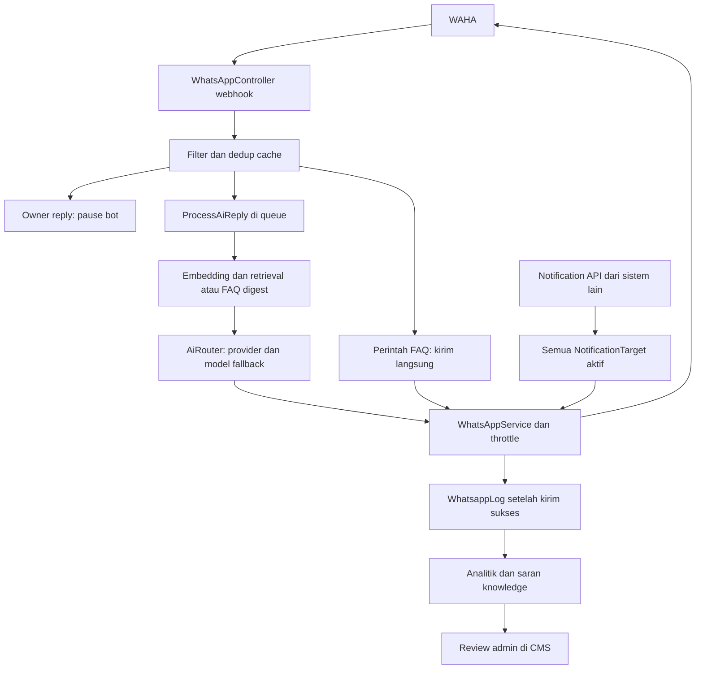

# Audit dasar rencana AI Agent

8 September 2026; commit `6690c1b`. Referensi file di bawah relatif terhadap root repository agar dapat digunakan dari checkout lain. Nomor baris adalah snapshot kajian, perlu diperiksa kembali saat implementasi.

## Batas bukti

Kajian membaca source, lockfile, konfigurasi deployment, dan test yang ada, serta halaman publik Mitfara/dokumentasi resmi. Tidak membaca `.env`, data pelanggan, atau log produksi; tidak menjalankan aplikasi, test suite, migrasi, scheduler, deployment, atau mengirim WhatsApp. Tidak ada bukti bahwa checkout lokal identik dengan release aktif.

“Ditemukan pada kode” berbeda dari “terjadi di produksi”. Nilai `BotConfig` produksi dapat mengalahkan default konfigurasi. Firewall, versi WAHA aktif, kapasitas server, dan perilaku sistem LMS eksternal belum diverifikasi.

## Alur saat ini

## Fondasi yang sudah tersedia

| Kemampuan | Bukti kode | Nilai untuk pengembangan |
|---|---|---|
| Laravel/PHP modern | `composer.json:9`; `composer.lock` mengunci Laravel `v13.15.0` | Pertahankan investasi yang sudah berjalan |
| Jalur WAHA terpusat | `app/Services/WhatsAppService.php:19`; `routes/api.php:14` | Tempat adapter/outbound dikembangkan bertahap |
| Routing FAQ vs AI | `app/Http/Controllers/Api/WhatsAppController.php:229` | Menu tetap dapat menjadi cadangan yang teruji |
| Multi-provider dan profil AI | `app/Services/Ai/AiRouter.php:39`; `config/ai_profiles.php:40` | Reuse failover, tracing, dan pemisahan circuit scope |
| RAG sudah terpasang | `app/Jobs/ProcessAiReply.php:112`; `app/Services/Ai/KnowledgeRetrievalService.php:22` | Tidak perlu mulai RAG dari nol |
| Review hasil belajar | `app/Jobs/KnowledgeSynthesizerJob.php:271`; `app/Http/Controllers/Cms/KnowledgeSuggestionController.php:35` | Pertahankan status pending dan persetujuan admin |
| Takeover admin | `app/Jobs/ProcessAiReply.php:45`, `:253`, `:285` | Guard sudah ada, perlu diperluas sampai pengiriman sebenarnya |
| Analitik pelanggan | `app/Models/ConversationAnalysis.php:10`; `routes/console.php:23` | Dapat dipakai untuk insight, terpisah dari bukti transaksi |
| Notifikasi operasional | `app/Http/Controllers/Api/InternalNotificationController.php:129` | Kontrak lintas layanan yang harus dijaga |
| Test dasar | `tests/Feature/WhatsAppWebhookVerificationTest.php`; `tests/Feature/Ai/AiRouterOrchestrationTest.php` | Titik awal regression suite |

## Temuan prioritas

### A01 — Model embedding yang dirujuk sudah dihentikan

**Bukti:** `app/Services/Ai/EmbeddingService.php:17` menetapkan `text-embedding-004`, dan `:26` memakai Gemini Developer API. Google mencatat shutdown 14 Januari 2026. [Changelog Gemini](https://ai.google.dev/gemini-api/docs/changelog#january-14-2026)

**Dampak yang mungkin:** panggilan embedding gagal, retrieval kosong, lalu `ProcessAiReply.php:113` memakai FAQ digest. Bot masih dapat menjawab, tetapi sumber yang ditemukan tidak lagi spesifik terhadap pertanyaan. Perlu observasi runtime untuk memastikan dampaknya.

**Rencana:** model/provider configurable; indeks baru paralel; fingerprint model+dimensi+preprocessing; cache berversi; metrik kegagalan embedding. Rebuild lama hanya memeriksa `content_hash` (`RebuildKnowledgeIndexJob.php:32–39`), sehingga mengganti model tanpa mengganti aturan rebuild akan melewatkan dokumen yang teksnya sama.

Default chat `gemini-2.0-flash` juga muncul pada `config/ai_profiles.php:53`; changelog Google mencatat shutdown 1 Juni 2026. Audit seluruh model aktif dan fallback, tetapi jangan mengganti model produksi berdasarkan default repo saja. [Changelog Gemini](https://ai.google.dev/gemini-api/docs/changelog#june-1-2026)

### A02 — Akses API sensitif belum dilindungi di route aplikasi

**Bukti:** `routes/api.php:18`, `:31`, `:39`, `:46`, `:54`, `:60` memuat FAQ mutasi, log, send/reconnect WAHA, config, dan analytics tanpa middleware auth yang terlihat. `bootstrap/app.php` tidak menambahkan autentikasi global API. `app/Http/Controllers/Api/BotConfigController.php:31` mengembalikan konfigurasi; model tidak mendefinisikan penyembunyian nilai sensitif.

**Dampak:** potensi pembacaan data/secret dan perubahan bot jika ingress mengizinkan akses. Belum melakukan pemeriksaan keterjangkauan endpoint publik.

**Rencana:** inventaris caller → autentikasi/role per endpoint → masking rahasia → uji CMS dan integrasi lama → enforcement terarah. Jangan memakai rotasi key massal yang memutus semua consumer. Webhook masuk perlu autentikasi yang berbeda dari API key Laravel menuju WAHA.

### A03 — Batas retry antrean lebih pendek daripada pekerjaan

**Bukti:** `config/queue.php:43` default `retry_after=90`; `ProcessAiReply.php:26` timeout 175 detik; worker pada `docker-compose.prod.yml:106` dan `docker-compose.dokploy.yml:123` memiliki timeout 200 detik. Rebuild indeks memiliki timeout 300 detik (`RebuildKnowledgeIndexJob.php:21`).

**Dampak:** saat ada lebih dari satu worker, job yang belum selesai bisa tersedia lagi. Satu nilai timeout worker tidak mewakili semua job; Laravel dapat menggunakan timeout khusus pada job. Nilai efektif produksi belum diketahui.

**Rencana:** inventaris seluruh job; atur reservation lebih panjang dari timeout efektif terpanjang plus margin pada setiap connection. Batasi total waktu operasi, termasuk retry AI, embedding, throttle, dan HTTP WAHA. Pisahkan pekerjaan lambat dari chat sebelum autoscaling.

### A04 — Identitas pesan belum tahan restart dan seluruh lifecycle

**Bukti:** `WhatsAppController.php:194–201` dedup cache 30 detik; `ProcessAiReply.php:32–38` tidak menerima message ID; `:243–249` membandingkan isi selama 3 detik; `:258–272` log dibuat setelah kirim.

**Dampak:** retry terlambat, crash sesudah kirim, dan overlap worker bisa menghasilkan duplikasi atau pesan hilang. `WhatsAppController.php:144–151` membuang pesan berumur lebih dari 60 detik, termasuk kemungkinan pesan valid saat outage.

**Rencana:** durable inbox unique message/session, penyimpanan sebelum acknowledgement, outbox dengan delivery status, rekonsiliasi hasil kirim ambigu, dan ordering per percakapan. Ini mengurangi duplikasi; tidak mengklaim pengiriman exactly-once dari WAHA.

### A05 — Kegagalan kirim dapat dianggap pekerjaan selesai

**Bukti:** `WhatsAppService.php:83`, `:118` mengembalikan false saat error; `ProcessAiReply.php:258–274` tidak menjadwalkan ulang atau melempar pada hasil false. Notification job memiliki perilaku retry berbeda.

**Rencana:** keluaran pengiriman bertipe `sent`, `retryable_failure`, `permanent_failure`, atau `unknown`. Pesan yang timeout setelah mungkin diterima WAHA masuk rekonsiliasi, bukan langsung dikirim ulang.

### A06 — Rekonsiliasi webhook dapat memulai ulang session

**Bukti:** `EnsureWahaWebhook.php:29–39` melakukan PUT tanpa perbandingan; `routes/console.php:19` menjalankannya tiap 30 menit; `docker/entrypoint.sh:29` saat boot; `WhatsAppController.php:75–87` menjadwalkan konfigurasi ulang setelah WORKING, dengan debounce.

Dokumentasi WAHA menyatakan update session aktif menghentikan lalu menjalankannya kembali. Kombinasi kode ini berpotensi menimbulkan restart rutin dan restart tambahan setelah WORKING. Debounce membatasi pengulangan langsung, bukan menghapus risikonya. Harus dicocokkan dengan versi terpasang. [Session WAHA](https://waha.devlike.pro/docs/how-to/sessions/)

**Rencana:** pin build yang terbukti berjalan; read/compare/preserve config; satu lock recovery; mutasi hanya saat drift nyata. Penambahan Python cukup di belakang Laravel. Perubahan HMAC yang membutuhkan update WAHA harus menjadi rilis kanal tersendiri dengan dampak restart yang dinyatakan.

### A07 — Deployment app mengubah layanan lain secara otomatis

**Bukti:** `docker/entrypoint.sh:9`, `:27`, `:29`, `:31`, `:35`, `:42`: install dependency, migrate, update webhook, seeding, analitik, dan migrate lagi dari worker/scheduler. Banyak kegagalan diabaikan dengan `|| true`. Seeder FAQ memakai `updateOrCreate` sehingga seeding bukan operasi tanpa efek.

**Rencana:** build immutable, satu release migration job dengan lock dan kegagalan terlihat, seed konten secara eksplisit, readiness, deployment hanya service yang berubah. Python memakai Dockerfile/entrypoint terpisah. Simpan WAHA image digest dan volume session; jangan melakukan stack-wide down/up untuk perubahan AI.

### A08 — Satu antrean dan throttle dapat menahan layanan bersama

**Bukti:** kedua compose menjalankan `--queue=default`. `WhatsAppSendThrottle.php:43`, `:95`, `:104` dapat menunggu/sleep; FAQ dikirim dalam request webhook. Batch knowledge dan recovery memakai jalur antrean yang sama.

**Rencana:** pisahkan queue dan kapasitas secara bertahap, tetap membaca backlog default sampai habis. Pakai penjadwalan delayed outbound dengan fairness antara chat dan notifikasi; jangan menambah worker untuk melampaui pembatas kanal. Kuota provider juga perlu dipisahkan: beda circuit scope tidak memisahkan kuota akun API.

### A09 — Human takeover belum cukup untuk transaksi dan kasus CS

**Bukti:** `WhatsAppController.php:203–209` mengembalikan respons saat pause sebelum menyimpan pesan pelanggan; `:339` menghapus history; `:348–356` menjadwalkan replay pesan sebelum pause. `HumanTakeoverController.php:44–49` menghapus pause DB, sementara guard AI juga membaca cache. Guard pada `ProcessAiReply.php:253` terjadi sebelum penantian di throttle.

**Dampak:** konteks admin hilang, resume tidak konsisten, atau AI mengirim sesudah admin mengambil alih di tengah penantian.

**Rencana:** persist semua inbound; ownership/versi percakapan; final guard tepat saat pengiriman; cancel respons usang; resume eksplisit untuk kasus khusus dengan ringkasan admin. Pesan yang telanjur diserahkan ke provider tidak selalu dapat dibatalkan; UI harus membedakan pending dari in-flight.

### A10 — Invalidasi konfigurasi terlalu luas

**Bukti:** `app/Http/Controllers/Api/BotConfigController.php:91` memanggil `Cache::flush()`. Cache yang sama menyimpan history, dedup, takeover, throttle, echo suppression, dan debounce WAHA.

**Rencana:** invalidasi hanya namespace konfigurasi; pisahkan state bisnis persisten dari cache. Jangan menggunakan flush seluruh cache untuk menjalankan rollback agent.

## Celah kualitas dan fungsi bisnis

| Celah | Bukti dan implikasi | Perbaikan |
|---|---|---|
| Prompt berorientasi FlexiLearn/Lifetime | Migrasi `2026_08_11_105812_update_ai_system_prompt_sales_agent.php:14`, `:39`, `:51`, `:64`; harga dan arahan menempel pada prompt | Pisahkan persona, kebijakan sales/CS, dan fakta produk terversi |
| Satu potongan per sumber | `RebuildKnowledgeIndexJob.php:80`, `:104` mengambil awal 500/800 karakter; schema unique source_type/source_id | Pecah berdasarkan bagian dan varian; jangan membuang isi akhir dokumen |
| Retrieval hanya pesan terakhir | `ProcessAiReply.php:105–112`, sebelum history dibaca pada `:139` | Query kontekstual dari pesan terbaru, ringkasan, dan program yang sedang dibahas |
| Semua embedding dipindai | `KnowledgeRetrievalService.php:39–67` memuat seluruh indeks lalu cosine | Ukur ukuran/latensi; filter metadata, hybrid search bila perlu; vector store opsional |
| Provenance tidak ikut hasil | `KnowledgeRetrievalService.php:59` hanya menyimpan content/score untuk hasil | Sertakan source ID/URL, versi, validitas dan fakta yang dipakai |
| Materi kompetitor bisa masuk jawaban | `TrainingMaterialController.php:31`, `:68`; rebuild mengecualikan chat_export saja pada `:101` | Pisahkan fakta produk, coaching internal, riset kompetitor, serta sumber terlarang |
| Ingatan singkat | `ProcessAiReply.php:179–196`: default 4 entry, TTL 1.800 detik, truncation 300/250 karakter | Profil persisten dan ringkasan dengan evidence; recent turns sebagai tambahan |
| Input dipotong | `ProcessAiReply.php:105` membatasi AI input 600 karakter | Simpan pesan penuh yang dibatasi aman; ringkas/split sadar makna; jangan kehilangan kebutuhan di akhir |
| Belum ada workflow lead/registration/ticket | Inventaris model, route, dan migration tidak menunjukkan modul tersebut | Modul baru di belakang fitur yang mati secara default |
| “Sukses” dari penilaian LLM | `KnowledgeSynthesizerJob.php:29–34` memakai resolved dan intent; analitik harian | Bedakan intent, resolved CS, registered, dan paid berdasarkan evidence |
| Notification API fan-out internal | `InternalNotificationController.php:141`, `:164–177` memakai semua target aktif | Pertahankan kontrak; event/customer notification baru dengan recipient eksplisit |
| Media bukan alur agent saat ini | Filter media `WhatsAppController.php:135` dan sekitarnya | Handoff text dahulu; voice/OCR hanya backlog lanjutan, bukan verifikasi pembayaran |

## Website yang perlu dikurasi

Homepage memuat A1–B2 di sejumlah bagian, sedangkan kurikulum/FAQ juga menyebut A1–B1. Sertifikat keikutsertaan dibedakan dari ujian Goethe mandiri; garansi free class disebut dengan S&K yang perlu dilengkapi. PIC program harus menetapkan cakupan yang sah untuk masing-masing varian. [Homepage Mitfara](https://mitfara.com/)

Halaman harga memiliki kategori online, offline, private, bundling, dan FlexiLearn beberapa bahasa. Banyak CTA mengarah ke admin. Karena itu, “semua paket dapat langsung checkout” belum dapat dipastikan dari halaman ini. [Harga Mitfara](https://mitfara.com/harga)

Audit tidak menyalin harga atau rekening ke rencana sebagai instruksi yang berlaku. Data transaksi perlu persetujuan bisnis dan masa berlaku, agar dokumen perencanaan tidak berubah menjadi sumber harga usang.

## Pengujian yang belum dilakukan

Test yang tersedia telah dibaca, belum dijalankan. `phpunit.xml` merujuk SQLite memory dan array cache, tetapi ini tidak membuktikan isolation efektif jika ada cached config atau override environment. `KnowledgeRetrievalServiceTest.php:33` mencatat keterbatasan coverage retrieval karena migrasi SQLite; komentar ini perlu dibuktikan kembali, bukan diasumsikan sebagai error aktif.

Fase 0 harus menyiapkan MySQL disposable dan mock HTTP untuk menguji behavior database queue, lock, migration, dan retry yang tidak terwakili oleh SQLite/sync queue. Daftar skenario dan gerbang rilis terdapat di [ROLLOUT.md](ROLLOUT.md).
